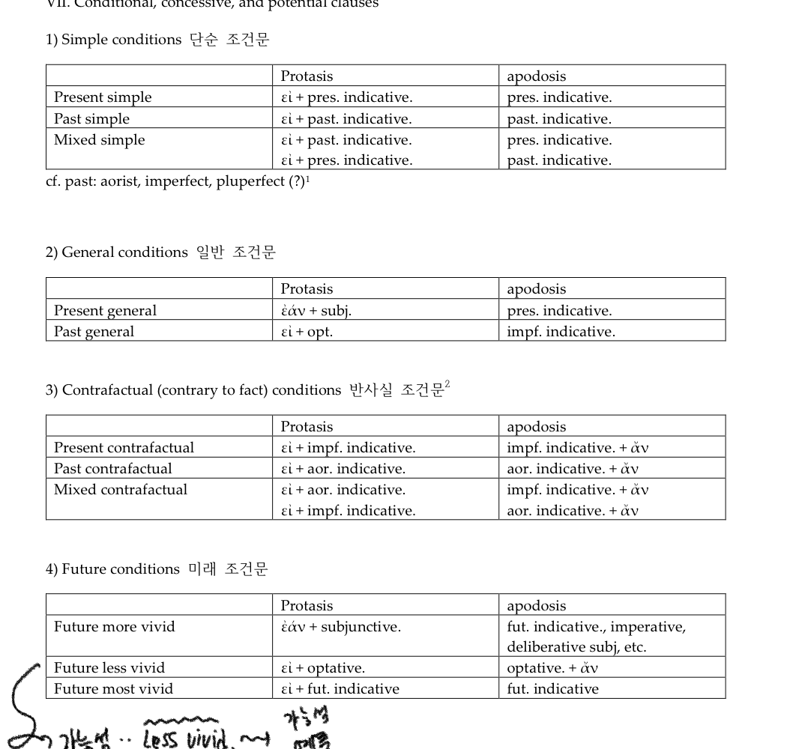

# Conditional

조건문

네가지 타입

1) 단순 조건문; 현재나 과거의 특정한 행위를 묘사한다. 일반적으로 조건절에서 묘사되는 행위가 실제로 발생했는지, 발생하지 않았는지에 대해서는 완전히 중립적이다. 조건절과 주절에 모두 현재 혹은 과거(past: aorist, imperfective, pluperfect) 직설법을 포함한다.

2) 일반 조건문: 현재나 과거의 일반적 사실, 관습적이거나 반복적인 사실들. 조건절의 행위가 진짜로 일어났는지에 대해서는 함축이 없다. 주절에는 보통 현재나, imperfect 직설법을 가지고, 조건절에는 접속법 혹은 희구법을 가진다. 이 조합에 의해서 종류가 결정되기 때문에 이 일반 조건문들은 섞일 수 없다.

3) 반사실적 조건문: 특정하거나 일반적인 행위를 묘사하며, 조건절의 행위가 일어나지 않았다는 것을 주장하는 조건문이다. 이들은 past 직설법을 조건절과 주절 모두에 가지며, αν을 주절에 가진다.

4) 미래 조건문: 특정하거나 일반적인 행위를 묘사. 그리고 일어날법한 정도를 다르게 묘사하기 위해서 여러가지 법들을 사용한다. 접속법이 가장 많이 쓰인다. 접속법은 결과에 대한 중립적 혹은 조건이 아마도 만족될지에 대한 의견에 대해서 중립적이다. 희구법은 만족되지 않을 가능성이 높다는 것을 주장하며, 조건절의 직설법은 보통 위협이나 경고의 암시를 담고 사용된다.

 

다양한 종류의 조건문들은 분사를 통해서도 표현될 수 있다. 이 경우에 조건절은 분사가 되며, 주절은 변하지 않은채로 남아 있다. 부정은 여전히 μη로표현되면 주절에서는 ου가 쓰인다. 

B) 양보절

εαν 이나 ει 옆에 και가 추가된 조건절이다. ει και, και ει 둘다 쓰일 수 있는데 전자일 경우 다른 의미로 쓰이지 않은 것인지 잘 확인할 필요가 있다.

C) 가능성

potential indicative는 imperfect(현재 시점) 혹은 aorist(과거 시점) 직설법을 αν과같이 사용한다. 또한, 사실과 다른 무언가를 지시하며, 과거에 잠재적 이었거나 과거에 반복되었거나 일반적인 사실을 말한다. 

