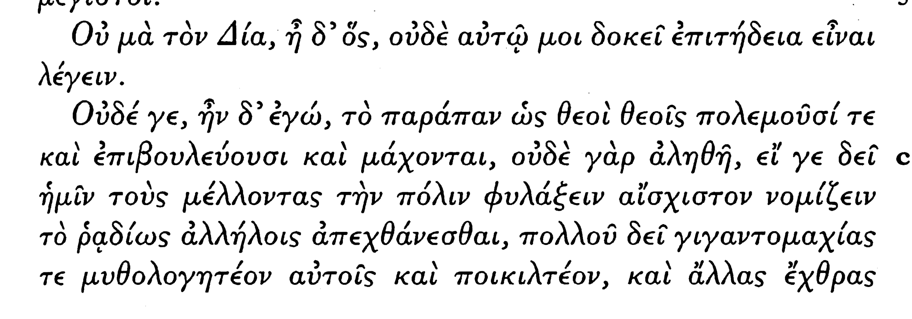

# 378b

그가 말했다. “신께 맹세코 아닙니다, 말하는 것에 적합한 것이 절대로 아닌 것처럼 저에게도 보입니다.“ 

επιτηδεια: 3격을 취하는 형용사

내가 말했다. ”만약 우리의 도시를 지킬 이들에게 서로를 쉽게 적대하는 것이 수치스럽다는게 생각하는 것이 필수적이라면, 마치 신들이 신들에게 전쟁을 벌이고, 음모를 꾸미며 싸운다는 것 - 절대로 참이 아니기 때문에 - 전부 역시 (말하는 것에 적합한 것이) 절대 아닐 것일세.    

δει문장의 주어로 기간토마키아스 (복수 4격으로 봄)를 취한 다음에 verbal adjective의 목적어로 그들을 받아서 해석

이들에겐 신들의 전쟁들, 다른 수많은, 신들과 영웅들이 그들의 혈족과 가족들을 향한 모든 종류의 불화들이 이야기해 준다거나 이와 관련된 수를 옷에다 놓아주는 일 또한 결코 있어서는 아니 되네.

τε καὶ ἐπιβουλεύουσι καὶ μάχονται—οὐδὲ γὰρ ἀληθῆ—εἴ γε δεῖ ἡμῖν τοὺς μέλλοντας τὴν πόλιν φυλάξειν αἴσχιστον νομίζειν τὸ ῥᾳδίως ἀλλήλοις ἀπεχθάνεσθαι—πολλοῦ δεῖ γιγαντομαχίας τε μυθολογητέον αὐτοῖς καὶ ποικιλτέον, καὶ ἄλλας ἔχθρας πολλὰς καὶ παντοδαπὰς θεῶν τε καὶ ἡρώων πρὸς συγγενεῖς τε καὶ οἰκείους αὐτῶν—ἀλλ᾽ εἴ πως μέλλομεν πείσειν ὡς οὐδεὶς πώποτε πολίτης ἕτερος ἑτέρῳ ἀπήχθετο, οὐδ᾽ ἔστιν τοῦτο ὅσιον, τοιαῦτα λεκτέα μᾶλλον πρὸς

우리의 도시를 지키게 될 수호자들이 서로서로를 쉽게 미워하는 것이 수치스럽다고 생각해야 할 필요가 있다면, 신들이 신들에게 전쟁을 벌이고, 음모를 꾸미며 싸운다는 것은 - 이는 절대로 참이 아닌데 - 는 전적으로 역시 이야기되어서는 안됩니다, - 더더욱이나 신들의 전쟁 그리고 신들과 영웅들이 그들의 혈족과 가족들과 벌이는 수 많은, 그리고 모든 종류의 불화들은 수놓아지고, 신화로 이야기 되어서는 더더욱 안될 것입니다. 대신 만약에(그러기는 커녕) 우리가 시민들이 그 전까지 한번도 각자가 각자에게 다툼을 일으키지 않았고,  이(다툼을 벌이는) 것이 불경한 것이라고 설득하고자 한다면, 이러한 것들이 노인 남자와 노인 여자, 그리고 나이를 많이 먹은 장로들에 의해서 아이들에게 곧바로 더 많이 말해져야만 하며, 

τὰ παιδία εὐθὺς καὶ γέρουσι καὶ γραυσί, καὶ πρεσβυτέροις(dative of interest?) γιγνομένοις καὶ τοὺς ποιητὰς ἐγγὺς τούτων ἀναγκαστέον λογοποιεῖν. Ἥρας δὲ δεσμοὺς ὑπὸ ὑέος καὶ Ἡφαίστου ῥίψεις ὑπὸ πατρός, μέλλοντος τῇ μητρὶ τυπτομένῃ ἀμυνεῖν, καὶ θεομαχίας ὅσας Ὅμηρος πεποίηκεν οὐ παραδεκτέον εἰς τὴν πόλιν, οὔτ᾽ ἐν ὑπονοίαις πεποιημένας οὔτε ἄνευ ὑπονοιῶν. ὁ γὰρ νέος οὐχ οἷός τε κρίνειν ὅτι(무엇이) τε ὑπόνοια καὶ ὃ μή, ἀλλ᾽ ἃ ἂν (τηλικοῦτος ὢν) λάβῃ /ἐν ταῖς δόξαις /- δυσέκνιπτα

이들 곁에서 시인들이 그것들과 비슷한 것을 이(원로)들을 위해 이야기를 짓도록 강제되어야만 합니다.

하지만 아들에 의한 헤라의 결박과, 그가 맞고 있던 어머니를 지키려고 하던 중에 일어난 헤파이스토스의 아버지에 의한 추락, 그리고 호메로스가 지은 것과 같은 신들의 전쟁들은 도시 안으로 받아들여져서는 안됩니다. 숨겨진 의미 안에서 지어진 것들도, 없이 지어진 것들도 말입니다. 왜냐하면 젊은이는 그러한 것들이 숨은 의미를 지녔는지 않았는지를 판단하지 못하기 때문이고  그것들을 그러한 나이에 있는 사람은 그가 의견으로써 가진 것을 씻어내기 어려울 것이며 바뀌기도 어렵게 되게 하는 것을 선호할 것입니다.

αμεταστατα: unchangable 

τε καὶ ἀμετάστατα φιλεῖ γίγνεσθαι: ὧν δὴ ἴσως ἕνεκα / περὶ παντὸς(denote object) ποιητέον / ἃ πρῶτα ἀκούουσιν ὅτι κάλλιστα μεμυθολογημένα πρὸς ἀρετὴν / ἀκούειν.

바로 이런 까닭에, 그들이 첫번째로 듣는 것이 가장 훌륭하게 덕에 대해서 듣도록 이야기되게 만드는 것이 무엇보다도 우선해야만 한다.

모든 것보다도 그들이 가장 먼저 듣는 것이 이야기되게 가장 아름다운 것들로 만들어야만 합니다.

παντος: gen, adj , sg, neut 

πρωτα: before, in front

μεμυθολογημενα ; part, dual, perf, mp, fem, acc

ἔχει γάρ, ἔφη, λόγον. ἀλλ᾽ εἴ τις αὖ καὶ ταῦτα ἐρωτῴη ἡμᾶς, ταῦτα ἅττα τ᾽ ἐστὶν καὶ τίνες οἱ μῦθοι, τίνας ἂν φαῖμεν;

φαιμεν: opt. 1st. pl. pres

그건 말이 됩니다. 그러나 이번에 어떤 이가 우리에게 이런 것을 묻는다면, 즉 이러한 것들이 무엇이며 어떤 것들이 이러한 이야기들이냐 묻는다면, 우리는 무엇을 대답하겠습니까?

καὶ ἐγὼ εἶπον: ὦ Ἀδείμαντε, οὐκ ἐσμὲν ποιηταὶ ἐγώ τε καὶ σὺ ἐν τῷ παρόντι, ἀλλ᾽ οἰκισταὶ πόλεως: οἰκισταῖς δὲ τοὺς μὲν τύπους προσήκει εἰδέναι ἐν οἷς δεῖ μυθολογεῖν τοὺς ποιητάς, παρ᾽ οὓς ἐὰν ποιῶσιν οὐκ ἐπιτρεπτέον, οὐ μὴν αὐτοῖς γε ποιητέον μύθους.

 그러자 내가 말했다. 아데이만토스, 나나, 자네나 우리는 있는 이 곳에서 시인이 아니라 나라의 수립자일세:  수립자들에게 속해 있다네 본들을 아는 것이 - 그 본들은 어떤 종류냐면 시인들이  그 안에서 이야기 할 필요가 있는 것 -  그것들에 반해서 그들이 시를 짓는다면 허락되지 않아야만 하네, 그들이 스스로 시를 지어야만 하는 것은 아무튼 분명히 아닐세.

τυπυς: τυποσ: 본, 틀

ειδεναι: to know, perf. inf.

επιτρεπτεος: one must permit 

ὀρθῶς, ἔφη: ἀλλ᾽ αὐτὸ δὴ τοῦτο, οἱ τύποι περὶ θεολογίας τίνες ἂν εἶεν;

옳습니다. 그가 말했다. 그러나 이 바로 그것, 즉 신들의 이야기에 대한 본은 무엇이 될 수 있을까요?

τοιοίδε πού τινες, ἦν δ᾽ ἐγώ: οἷος τυγχάνει ὁ θεὸς ὤν, ἀεὶ δήπου ἀποδοτέον, ἐάντέ τις αὐτὸν ἐν ἔπεσιν ποιῇ ἐάντε ἐν μέλεσιν ἐάντε ἐν τραγῳδίᾳ.δεῖ γάρ.

아마도 그런 어떤 것일 세. 누군가 신들이 어떤 특성으로 있게 되었는지, 항상 진실되게 되돌려주어야만 하네, 그들을 서사시나, 서정시 또는 비극으로 짓든 간에.

정말 그래야만 합니다.

οὐκοῦν ἀγαθὸς ὅ γε θεὸς τῷ ὄντι τε καὶ λεκτέον οὕτω;

그렇다면 신은 본성상 정말로 좋기에 그렇게 말해야만 하겠지?

τί μήν;

물론이죠

ἀλλὰ μὴν οὐδέν γε τῶν ἀγαθῶν βλαβερόν: ἦ γάρ;

하지만 좋은 것들 중에 해로운 건 절대로 없지 않은가: 안 그런가? 알라 멘 - 

οὔ μοι δοκεῖ.

없을 것으로 생각됩니다.

ἆρ᾽ οὖν ὃ μὴ βλαβερὸν βλάπτει;
해치지 않는 것이 해치지는 않겠지요?

οὐδαμῶς.

전혀 아닙니다.

ὃ δὲ μὴ βλάπτει κακόν τι ποιεῖ;

그렇다면 해치지 않는 것이 나쁜 짓을 하겠는가?
οὐδὲ τοῦτο.

그 또한 아닙니다.

ὃ δέ γε μηδὲν κακὸν ποιεῖ οὐδ᾽ ἄν τινος εἴη κακοῦ αἴτιον;

그러나 적어도 나쁜 짓을 하지 않는다면, 어떤 나쁜 것의 원인이 아니겠지?

πῶς γάρ;

어떻게 그러겠습니까?

τί δέ; ὠφέλιμον τὸ ἀγαθόν;

그렇다면 이건 어떤가? 좋은 것은 유익하지?

ναί.

맞습니다.

αἴτιον ἄρα εὐπραγίας;

그렇다면 잘함의 원인이겠지?

ναί.

맞습니다.

οὐκ ἄρα πάντων γε αἴτιον τὸ ἀγαθόν, ἀλλὰ τῶν μὲν εὖ ἐχόντων αἴτιον, τῶν δὲ κακῶν ἀναίτιον.

구로나꺼 좋은 것의 원인은 모든 것들이 아니라, 좋게 가지고 있는 것들의 원인이고, 나쁜 것들의 원인은 아니라네.

- πολλοῦ δει: *there wants much, far from it*
- φιλεῖ: be used to
- περὶ παντὸς ποιητέον : above all, 무엇보다도 더 해야만 한다.
- ὅτι κάλλιστα: such beautiful, 최상급 강조.
-